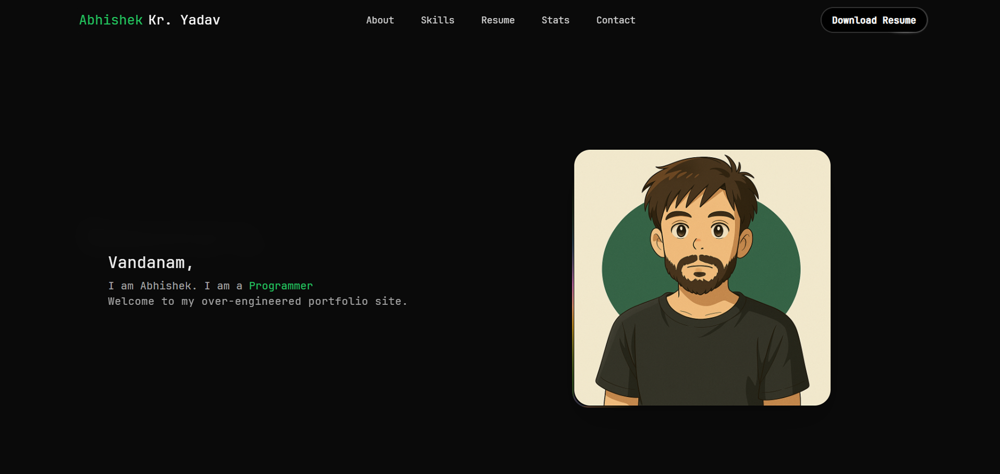

# Abhishek Kumar Yadav (AKY) - Portfolio

Welcome to the personal portfolio of Abhishek Kumar Yadav (AKY). This website showcases my projects, skills, and experience in software development. You can explore my work and learn more about my professional background.



## Live Demo

Check out the live demo of the portfolio at [https://abhishekkumaryadav.in/](https://abhishekkumaryadav.in/).

## Technologies and Libraries Used

This portfolio is built using modern web technologies and libraries to provide a responsive and interactive user experience. Here are some of the key technologies and libraries used:

- **React**: A JavaScript library for building user interfaces.
- **TypeScript**: A typed superset of JavaScript that compiles to plain JavaScript.
- **Vite**: A fast build tool and development server for modern web projects.
- **Tailwind CSS**: A utility-first CSS framework for rapid UI development.
- **NextUI**: A React UI library for building modern web applications.
- **React Router**: A library for routing in React applications.
- **Recharts**: A charting library for React.
- **Three.js**: A JavaScript library for creating 3D graphics in the browser.
- **Three Globe**: A library for creating interactive globes with Three.js.
- **Axios**: A promise-based HTTP client for making API requests.
- **Framer Motion**: A library for animations in React.
- **GSAP**: Powers the React Bits-inspired, scroll-linked word reveals in the About
  section using ScrollTrigger.
- **Lucide React**: A library of icons for React.
- **ESLint**: A tool for identifying and fixing problems in JavaScript code.
- **Prettier**: A code formatter for maintaining consistent code style.

## Getting Started

### About section animation

The story in `src/components/AboutMe.tsx` uses the reusable
`ScrollReveal` component in `src/components/ui/scroll-reveal.tsx`. Inspired by
[React Bits Scroll Reveal](https://reactbits.dev/text-animations/scroll-reveal),
it uses React-rendered word spans with the React Bits default reveal settings: words fade
from 10% opacity and 4px blur, staggered by 0.05 seconds, while the text's
3-degree rotation settles to zero. Progress follows scrolling without pinning
the section. Word spans wrap naturally at different widths.
Reduced-motion users see static, fully visible text. Each instance accepts plain
text, not nested interactive elements; the original paragraph semantics are retained.

Use Node.js 24.x for local development and deployment, as declared in
`package.json`.

### Experience scroll stack

The experience list uses a page-scroll wrapper inspired by
[React Bits Scroll Stack](https://reactbits.dev/components/scroll-stack).
Cards stick and subtly scale as the following card approaches. Experience cards
are always open, with equal-height grid rows sized to the tallest card; their
content and visual styling are retained.
The wrapper observes content height changes and keeps cards at their full,
equal height without internal scrollbars. Trailing space based on the card
height keeps the shared sticky boundary beyond the completed stack.
It adds an opaque backing and uses a regular list
layout when reduced motion is enabled. Stacking follows native page scrolling
without scroll interception or smoothing.

### Skills animation

Homepage skill category cards fade and slide in on viewport entry and out on
exit, replaying when scrolled back into view. Reduced-motion users see static
cards. Card contents and category navigation are unchanged.

### Projects animation

Homepage project cards fade and slide in from alternating left and right sides
on viewport entry and reverse on exit, replaying on subsequent entries.
Reduced-motion users see static
cards. Existing card content, links, and hover effects are unchanged.

### Homepage page-view total

The homepage footer reads `/api/page-views`, a Vercel Function that reports GA4
`screenPageViews` for `abhishekkumaryadav.in`, from November 11, 2024 through
today (in the property's timezone). It counts all site routes, including repeat
views, not unique visitors. It does not include other hostnames or `www`.
If historical traffic used other production hostnames, update the server filter
before interpreting the number as the full site total. Use a web-only GA4
property, or additionally restrict the server query to your website's stream.

Enable Google Analytics Data API in Google Cloud, create a dedicated service
account, and grant its email **Viewer** access through GA4 **Admin > Property
Access Management**. Configure:

- `GA4_PROPERTY_ID`: the numeric property ID, not the `G-...` measurement ID.
- `GA4_CREDENTIALS_JSON`: the complete service-account JSON.

For local development, put these in ignored `.env.local`. Compress the JSON to
one line, enclose it in single quotes, and preserve its JSON `\n` escapes.
Run `npm run dev`; Vite serves the same API handler locally. Restart after
changing environment variables. `npm run preview` serves only the static build,
not this API. For deployment, set the variables in Vercel's Production environment
and redeploy; paste the JSON without the enclosing dotenv single quotes.
Never prefix credentials with `VITE_`, commit them, or share them. Rotate any
exposed service-account key before use.

Successful responses are cached on Vercel's CDN for one hour and in browsers for
one minute. Errors are not cached and are logged; the counter stays hidden while
loading or if the request fails.
The counter is appended inline to the built-with credits in the same font size,
showing only the total and "views" after a valid total loads. It starts at
zero and counts up once when the footer enters the
viewport; reduced-motion preferences show the final total without animation.
GA4 processing adds further delay, so the displayed total does not increment
immediately on refresh. No database is needed.

Tracking uses explicit initial and router-navigation page views in `App.tsx`,
with the automatic initial page view disabled. In GA4 **Admin > Data Streams >
Web > Enhanced measurement > Page views > Show advanced settings**, disable
**Page changes based on browser history events** to avoid duplicate route views.
Verify one `page_view` for each page load, refresh, and back/forward or route
navigation in DebugView; scrolling and counter requests must not add views.
Historical duplicate events cannot be reliably corrected by this implementation.

Run `npm run test:page-views` for API contract and failure-path tests. Before
release, compare the endpoint against GA4 with the same date range and hostname
filter, and check that `/api/page-views` returns JSON while SPA routes still load.

### Vercel deployment

In your Vercel project, open **Settings > Build and Deployment > Node.js
Version**, select **24.x**, and save. Then trigger a new deployment. Node.js
20 is no longer supported by Vercel.

This template provides a minimal setup to get React working in Vite with HMR and some ESLint rules.

Currently, two official plugins are available:

- [@vitejs/plugin-react](https://github.com/vitejs/vite-plugin-react/blob/main/packages/plugin-react/README.md) uses [Babel](https://babeljs.io/) for Fast Refresh
- [@vitejs/plugin-react-swc](https://github.com/vitejs/vite-plugin-react-swc) uses [SWC](https://swc.rs/) for Fast Refresh

## Expanding the ESLint Configuration

If you are developing a production application, we recommend updating the configuration to enable type-aware lint rules:

- Configure the top-level `parserOptions` property like this:

```js
export default tseslint.config({
  languageOptions: {
    // other options...
    parserOptions: {
      project: ["./tsconfig.node.json", "./tsconfig.app.json"],
      tsconfigRootDir: import.meta.dirname,
    },
  },
});
```
